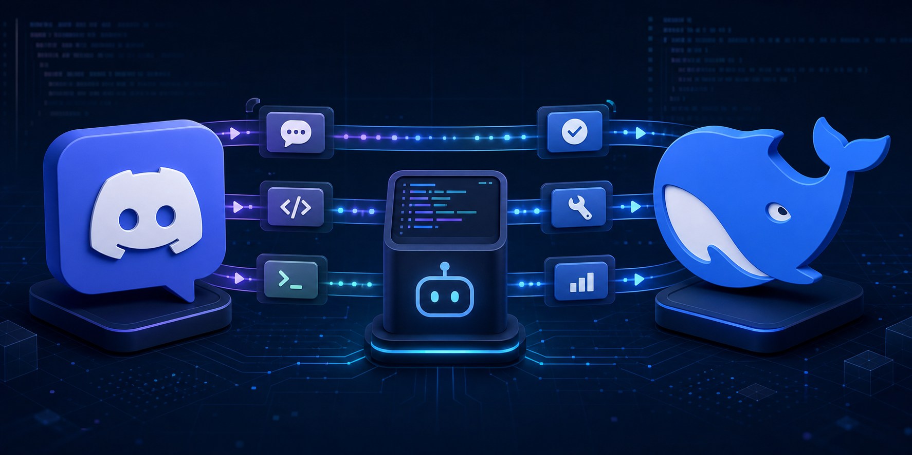

# dsh-discord

[](https://dshmarketplace.dev/plugins?q=dsh-discord)



Bidirectional Discord bridge and remote controller for DeepSeek Harness.

Listed in the independent community-run [DSH Marketplace](https://dshmarketplace.dev/plugins?q=dsh-discord) ([source](https://github.com/DshMarketPlace/dshmarketplace)).

The dedicated `discord` profile supports one owner and project across DMs, guild text channels, and threads. Each Discord conversation owns an independently persisted DSH Session. Owner DMs trigger directly; ordinary guild-channel messages require an explicit bot mention; an already-bound thread continues without repeated mentions. Slash commands never require a mention.

The bot invite requests View Channel, Send Messages, **Send Messages in Threads**, Read Message History, Embed Links, and Attach Files. `doctor` checks the same permission set. Discord server and channel permissions determine where the bot is visible; the plugin remains single-owner and fail-closed.

The controller includes natural text, `/dsh help/status/new/stop/steer`, `/model status/list/set`, coalesced progress, approvals, structured questions, image and text/code attachment ingress, durable event deduplication, Gateway reconnect, and managed daemon operation.

## Commands

All slash commands run without a bot mention. `/dsh new` clears the conversation; `/model set` switches the LLM provider/model for the current conversation, persists the choice as the new default, and — when the provider changes — resumes the same persisted Session on the new provider with the next message.

- `/dsh status` — current Session and Agent state
- `/dsh new` — create and bind a new Session
- `/dsh stop` — stop the current task
- `/dsh steer <text>` — steer the current task's nearest step
- `/model status` — current conversation model plus the saved default
- `/model list` — available providers and models
- `/model set <provider/model>` — switch provider/model (e.g. `deepseek-official/deepseek-v4-flash`) and save it as the default

The textual equivalents (`/model list`, `/model set …`, etc.) also work as DM messages.

Enable **Message Content Intent** on the Discord Developer Portal Bot page for natural guild-channel messages.

```bash
# Until an npm release is available, install the CLI from GitHub.
npm install --global github:suuuuuu-1/dsh-discord
dsh-discord setup --package-spec github:suuuuuu-1/dsh-discord
dsh-discord doctor
dsh-discord start

# or managed background mode
dsh-discord start --daemon
dsh-discord status
dsh-discord stop
```

The global CLI is only a launcher. The plugin itself is activated in the dedicated `discord` profile and remains bound to the single project selected during setup; it does not become active in every directory or in the `web` profile.

The Bot Token is stored only through DSH Credentials. See [README.zh.md](README.zh.md), [DESIGN.md](DESIGN.md), and [SECURITY.md](SECURITY.md).
